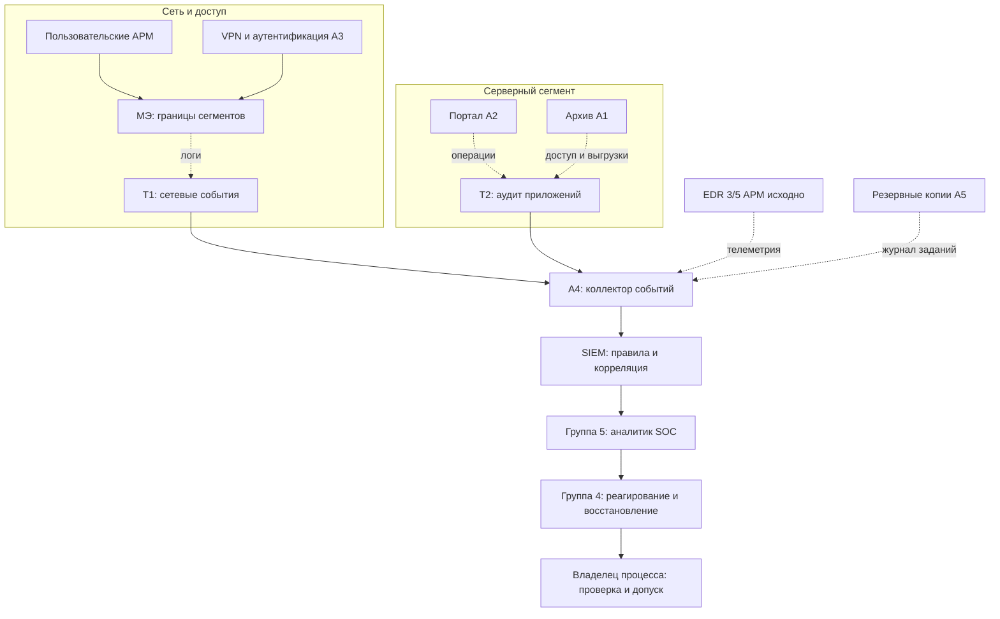

# Архитектура наблюдения за угрозами

**Т1 и Т2 — две основные опорные точки по карточке группы 4.** Дополнительные источники передают логи напрямую в A4. Стрелки на схеме означают **потоки журналов**, а не пользовательский трафик.

## Опорные точки
| Точка | Где | События | Тест |
|---|---|---|---|
| Т1 | МЭ между пользовательским, серверным и административным сегментами | allow/deny, src/dst, порт, VPN, сетевые аномалии | Контрольное запрещённое соединение отражено в SIEM |
| Т2 | Портал A2 и архив A1 | Вход, роль, чтение, изменение, утверждение, выгрузка | Контрольная операция видна с учётной записью и временем |

## Обязательные технические свойства
- Синхронизация времени (NTP).
- Буферизация при недоступности A4.
- Ограниченный доступ к журналам и защита от изменения.
- Оповещение об отсутствии событий от критичных источников.
- Срок хранения и правовое основание обработки логов — согласовать.
