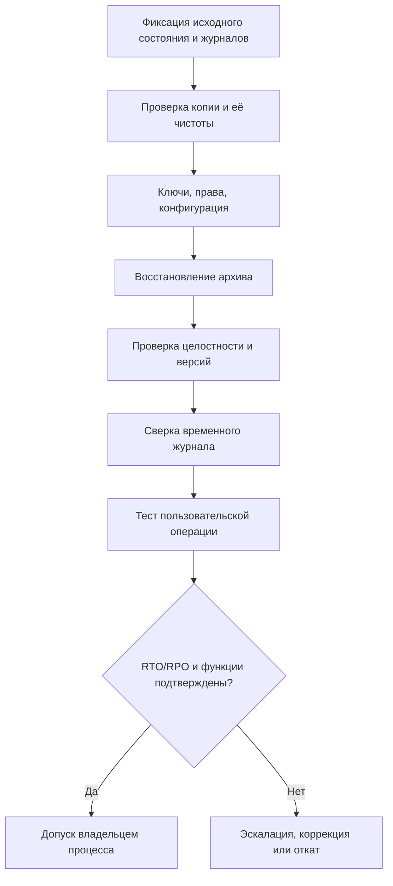

 # Восстановление архива A1

- **RTO:** 60 минут от остановки до восстановления доступа.
- **RPO:** 15 минут допустимого отставания восстановленных данных.
- **Временный журнал:** принимать новые материалы при простое, после восстановления выполнить сверку.

## Протокол испытания
- Время остановки:
- Время начала восстановления:
- Время возобновления работы:
- Фактический RTO:
- Время последней восстановленной записи:
- Фактический RPO:
- Результат сверки временного журнала:
- Контроль целостности:
- Тест пользовательской операции:
- Подпись/согласование владельца процесса:

Статус `success` программы резервирования не равен подтверждённой восстановимости.
