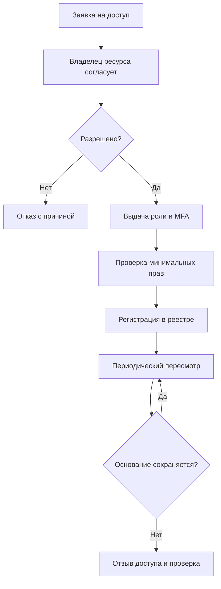

# Жизненный цикл доступа

Триггеры внеочередного пересмотра: увольнение, перевод, завершение договора, инцидент, изменение должности, неиспользуемая учётная запись. Для привилегированных и временных прав назначить более частый пересмотр; конкретную периодичность утвердить локальным актом.

## Контрольные вопросы
- Есть ли подтверждённый владелец каждого ресурса?
- Соответствует ли доступ должностной функции?
- Есть ли общие аккаунты, «вечные» подрядчики, забытые сервисные ключи?
- Кто может назначать себе права?
- Логируются ли выдача и отзыв прав?
