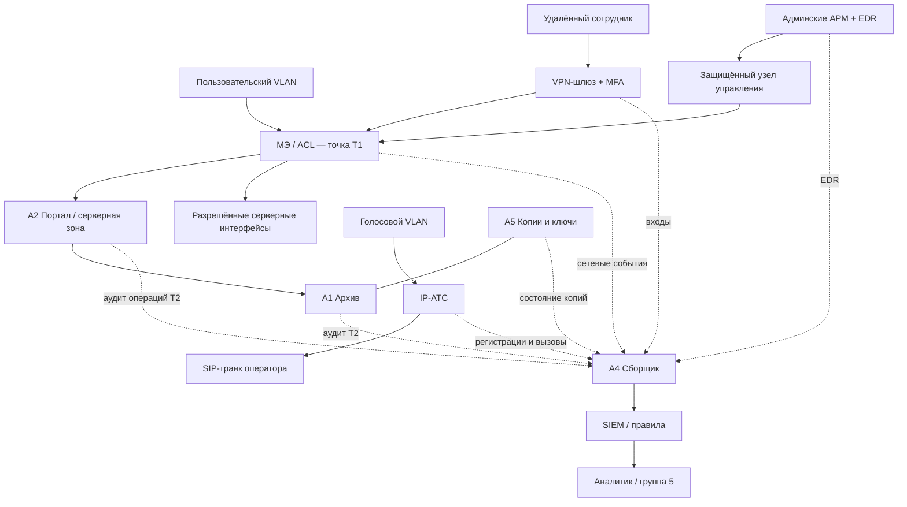

# Сетевая архитектура — целевая схема

Пунктир — **события**, сплошная стрелка — логически разрешённое взаимодействие. Связь архива с резервными копиями не означает открытый двусторонний сетевой доступ.

## Границы доверия
1. Внешняя сеть ↔ VPN/пограничные сервисы.
2. Пользовательский VLAN ↔ серверная зона.
3. Административная зона ↔ узел управления ↔ серверы.
4. Голосовой VLAN ↔ IP-АТС/оператор.
5. Рабочие системы ↔ изолированное хранение резервных копий.

Запретить транзит между пользовательским и административным сегментами по умолчанию. На МЭ хранить правила с владельцем, назначением, сроком и заявкой.
