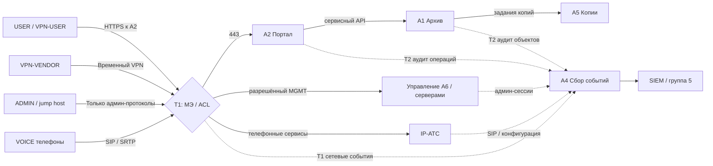

# 17 Контроль доступа на сетевом уровне — Т1

## 1. Зоны и доверие

| Зона | Содержимое | Доверие и граница |
|---|---|---|
| USER | Рабочие станции сотрудников | Недоверенная по отношению к ADMIN и BACKUP |
| SERVER | A2 портал, A1 архив, инфраструктурные сервисы | Доступ только к опубликованным приложениям и сервисным зависимостям |
| ADMIN | Выделенные административные АРМ/jump host | Привилегированные соединения только к управляемым узлам |
| VOICE | IP-телефоны, голосовые сервисы A6 | SIP/SRTP, DNS/NTP/provisioning по потребности; нет A1/A5 |
| VPN-USER | Удалённые сотрудники | Не шире USER; ограничить маршруты и MFA |
| VPN-VENDOR | Подрядчик | Временный маршрут только к jump/целевому узлу |
| MGMT | Интерфейсы управления коммутаторами, МЭ, IP-АТС | Доступ только из ADMIN через разрешённые каналы |
| LOG | A4 сборщик и хранилище | Приём событий от источников; просмотр только SOC/аудитором |
| BACKUP | A5 хранилище копий и ключи | Не доступно пользователям, отдельные роли оператора/восстановления |

> Реальные VLAN ID, адреса, DNS, DHCP, подсети, маршрутизаторы, физическая топология и SIP-порты неизвестны; поля подлежат инвентаризации. Разделение зон логическое и не требует утверждать наличие отдельного оборудования.

## 2. Проверяемая схема потоков

Пунктир — события наблюдения, сплошные стрелки — логические разрешённые бизнес/административные потоки. Это **не** означает, что весь трафик проходит через A4. На схеме опущены служебные соединения DNS/NTP и EDR, которые следует инвентаризировать отдельно.

## 3. Матрица контроля потоков

| ID | Источник → назначение | Сервис | Решение | Ограничения | События Т1 |
|---|---|---|---|---|---|
| F01 | USER → A2 | HTTPS/443 (пример) | Allow | Только адрес портала | accept, bytes, src/dst |
| F02 | USER → ADMIN/MGMT | RDP/SSH/все иные | Deny | Устранить известное избыточное правило | deny, rule_id |
| F13 | USER → A1 напрямую | Любые | Deny по умолчанию | Через A2, кроме утверждённых исключений | deny |
| F04 | VPN-USER → A2 | HTTPS | Allow | MFA, назначенная роль, срок | VPN + FW |
| F05 | VPN-VENDOR → jump host | Утверждённый сервис | Allow временно | Узел, IP, окно, заявка | session start/end |
| F14 | VPN-VENDOR → A1/A5 | Любые | Deny | Не выдавать широкий маршрут | deny |
| F15 | ADMIN → MGMT | SSH/HTTPS/RDP по узлу | Allow ограниченно | Именные админ-УЗ, запись сессий | admin_connect |
| F03 | A2 → A1 | Прикладной API | Allow | Только сервисная идентичность | flow + Т2 API |
| F08 | Источники → A4 | Агент / syslog TLS | Allow | Ограниченные источники, контроль доставки | ingest/heartbeat |
| F12 | A1/A2 → A5 | Backup service | Allow | Только задания и агенты | job/transfer |
| F09 | VOICE → IP-АТС | SIP/TLS, RTP/SRTP | Allow | Фактические порты и медиамаршрут уточнить | registration/call |
| F11 | VOICE → A1/A5/ADMIN | Любые | Deny | Не смешивать голосовой и админ-доступ | deny |
| F16 | ADMIN → IP-АТС MGMT | HTTPS/SSH по конфигурации | Allow | Только админ IP-АТС и jump | config_change |
| F17 | SOC → A4 | защищённый интерфейс | Allow | Только чтение для аналитика | audit_query |

Порты 443/22/3389/5061 — типовые ориентиры, **не** доказательство действующих портов. Для телефонии RTP-порты зависят от IP-АТС.

**Соответствие основному реестру:** F01, F02, F04, F05 сохранены; прямой USER→A1 — F13; VPN-VENDOR→A1/A5 — F14; ADMIN→MGMT — F15; A2→A1 — F03; источники→A4 — F08; A1/A2→A5 — F12; VOICE→IP-АТС — F09 (медиапоток отдельно F10); VOICE→A1/A5/ADMIN — F11; ADMIN→IP-АТС MGMT — F16; SOC→A4 — F17. Это исправление **только идентификаторов**, без изменения правил.

## 4. Известное нарушение: временное правило USER → ADMIN

**Подтверждено условиями:** после обслуживания создано временное правило с избыточным доступом. **Не подтверждено:** какие конкретно подсети, IP и порты, кто применил правило, использовал ли его нарушитель.

Алгоритм: 1) экспорт конфигурации и идентификатор правила; 2) найти заявку и владельца; 3) проверить реальные обращения в логах Т1; 4) выяснить нужный поток; 5) согласовать точное ограничение; 6) сделать резервную копию конфигурации; 7) применить правило в согласованное окно; 8) выполнить положительный тест законного доступа и отрицательный тест USER → ADMIN; 9) проверить журнал Т1 → A4; 10) сохранить diff, тест и план отката.

**Критерий закрытия:** запрещённый доступ блокируется, критичные разрешённые сервисы работают, события доставляются в A4, изменение утверждено и есть rollback. Не закрывать нарушение по одной записи «правило изменено».

## 5. Сетевая проверка IP-телефонии

- Проверить отдельный voice VLAN (или эквивалентное разграничение), DHCP options и адреса телефонов.
- Зафиксировать, где находится IP-АТС, куда направлены SIP REGISTER/INVITE, какие есть SIP-trunk и медиапотоки RTP/SRTP.
- Разрешить DNS/NTP/provisioning только к утверждённым серверам.
- Отделить управление IP-АТС от телефонов: интерфейс администрирования доступен только из ADMIN/MGMT.
- Исключить VOICE → A1/A5 и широкие VOICE → USER/ADMIN; разрешить нужные медиапотоки после инвентаризации.
- Проверить, что события SIP-регистрации, изменения dialplan и неудачные попытки аутентификации поступают в A4.
- При необходимости контролировать LLDP-MED, 802.1X/MAB, DHCP snooping/DAI на коммутаторах, **только после проверки совместимости**: поспешное включение может нарушить телефонию.

## 6. Доказательства и показатели

`rule_id | src_zone | src_ip/subnet | dst_zone | dst_ip | protocol | dst_port | action | purpose | owner | request_id | created | expires | hits | logging | review_date | test_result | rollback_id`

Показатели: доля правил с владельцем/основанием; доля просроченных исключений; число разрешённых USER→ADMIN без согласования (цель 0); доля критичных источников с heartbeat; доля разрешённых и запрещённых тестов с доказательствами.

Связано: [[03 Роли и матрица доступа]], [[07 Аудит МЭ и VPN]], [[09 IP-телефония]], [[18 Матрица наблюдаемости и правила SIEM]].
